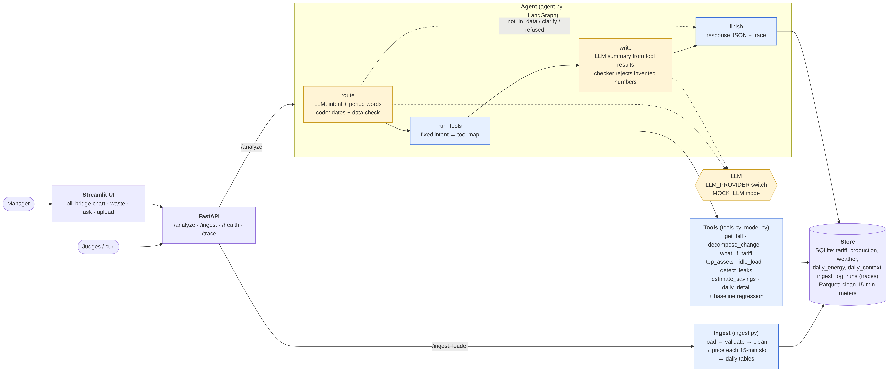

# How it works: complete guide for the demo, Q&A and live changes

Read this top to bottom once. Sections 1–4 explain the system, section 5 is the **live-change playbook**
(what to edit if a judge says "change X"), section 6 is Q&A by topic, section 7 is the demo script.
Numbers in this guide are from our data in `data/` (Q3 vs Q2 2026).

---

## 1. The problem in one page

- A factory's **electricity bill rose ~15%** vs last quarter. Finance asks **why**.
- Five possible causes: **tariff** (price per kWh changed), **volume** (made more), **product mix** (made more
  energy-heavy products), **weather** (hotter → more cooling), **waste** (energy nobody needed, e.g. a leak).
- Only waste is controllable. **Rule (Annex A): remove tariff, volume, mix and weather first; only the leftover is waste.**
  The parts must **add up** to the total. Savings must be **ranges**. The LLM may only quote **numbers from tools**.
- Inputs (Annex B): `meter_15min.csv` (kWh every 15 min, main meter + sub-meters), `tariff.csv` (price by period),
  `production.csv` (units per product per day, shift, holiday), `weather.csv` (degree-days per day).
- There is **no bill file**: the bill = Σ (kWh in each 15-min slot × price valid at that slot).
- Judged on: decomposition (25), waste/leak detection (15), savings + CO₂e (15), reasoning before blaming (10),
  LLM brief faithfulness (10), evaluation (5), engineering (10), architecture judgement (10).

**Our result on our data:** bill **+14.23%** = tariff **7.17** + volume **2.62** + mix **1.80** + weather **0.55**
+ waste **2.09** percentage points. Waste = mainly a **compressor air leak** (night load 5% → 35% of daytime).

---

## 2. Architecture in one picture



```
CSV / POST /ingest ─► ingest.py ─► store/ (SQLite tables + Parquet 15-min file)
                                        ▲
POST /analyze ─► agent.py (LangGraph) ──┤
     route ─► run_tools ─► write ─► finish(trace)
       │         │           │
       LLM     tools.py      LLM + checker.py
     (intent)  model.py    (summary wording)
```

**The one sentence to remember:** *code computes every number; the LLM only understands the question and words the
answer; a checker rejects any number the LLM invents.*

---

## 3. Walk-through of one question end to end

Question: `POST /analyze {"question": "Why did the bill go up?"}`

1. **`api.py` → `analyze()`** validates the body (Pydantic `AnalyzeRequest`: `question`, optional `period`,
   `compare_to`) and calls `agent.answer()`.
2. **`agent.answer()`** creates a `run_id` (`en-xxxxxx`) and runs the LangGraph graph with an empty state.
3. **Node `route`**:
   - `tools.data_range()` → data covers 2026-04-01..2026-09-30.
   - If `MOCK_LLM=false`: `llm_route()` sends `ROUTER_PROMPT` → the LLM returns JSON
     `{"intent": "decomposition", "period": null, "compare_to": null}`. If the LLM fails or returns bad JSON →
     `keyword_route()` (regex rules) is used instead. The trace records which one (`method: llm|keyword`).
   - **Code resolves the dates**: no period → `resolve("latest_quarter")` = 2026-07-01..09-30; base =
     `previous()` = 2026-04-01..06-30. `check_range()` confirms both exist in the data, otherwise `not_in_data`.
4. **Node `run_tools`**: `PLAN["decomposition"]` = `decompose_change` with two periods → calls
   `tools.decompose_change(...)`. Output converted to plain JSON (numpy → float).
5. **Node `write`**: `template()` always builds a deterministic summary. If the LLM is on, `WRITER_PROMPT` +
   tool results go to the LLM; `checker.invented_numbers()` checks every number in its text. Pass → use LLM text;
   fail → keep the template (`checker_passed=false` in the trace).
6. **Node `finish`**: builds the response JSON (`answer_type`, `summary`, `bridge`, `recommendations`, `result`,
   `assumptions`, `limitations`, `data_version`) and saves the run + all steps in the `runs` table.
7. `GET /trace/{run_id}` reads it back.

Stop paths: if `route` decides `not_in_data`, `clarification` or `refused` (or the period is invalid / outside the
data), the graph jumps straight to `finish` with a fixed message — **no tool is called, no number is produced.**

---

## 4. File-by-file explanation

### `app/config.py` — every assumption in one place
| Setting | Value | Used for |
|---|---|---|
| `PLANT_TZ` | Asia/Kolkata | converting UTC timestamps to local hours/dates (night, peak, days) |
| `PEAK_HOURS` | (18, 22) | which local hours get the `peak` tariff price |
| `NIGHT_HOURS` | (0, 5) | night window for leak detection and night kWh |
| `EMISSION_FACTOR` | 0.4 kg CO₂e/kWh | CO₂e savings |
| `SUBMETER_TOLERANCE` | 5% | validation check sub-meters vs main |
| `MAX_GAP_SLOTS` | 4 (= 1 hour) | longest gap we interpolate |
| `REPAIR_COST` | Rs 20k–50k | payback (assumed; not in the data) |
| `LLM_PROVIDER/MODEL/MOCK_LLM` | from `.env` | which LLM, or none |
| `REQUIRED` | Annex B columns | schema check per table |

### `app/db.py` — storage
- **SQLite** `store/app.db`: `tariff`, `production`, `weather` (cleaned copies of uploads), `daily_energy`
  (one row per day per meter: kwh, cost, idle_kwh, night_kwh, missing_slots), `daily_context` (one row per day:
  `u_<product>` units, degree-days, `is_holiday`, `holiday_mismatch`, `exclude_from_training`), `ingest_log`
  (every upload + validation report), `runs` (every question + full trace).
- **Parquet** `store/meter_clean.parquet`: the clean 15-min series (meter_id, ts, kwh, flag, date, hour, price,
  cost, is_production). Kept out of SQLite as the stack rule suggests for time series.
- **Data version** = number of successful uploads; stored in each run → "which data answered this question".

### `app/ingest.py` — the data pipeline (R1, R4)
`ingest(path, table)`:
1. **Read everything as text** (`dtype=str`, `on_bad_lines="skip"`): one malformed line (extra field) can't crash
   the load; skipped lines are counted as rejected.
2. **Schema check**: required columns missing → whole file `rejected` with the reason.
3. **`parse()`** — turns text into types and normalises spelling:
   - meters: `meter_id` stripped + lower-case (`HVAC ` → `hvac`); `ts` parsed as ISO-8601 with `utc=True`
     (handles `Z` and `+05:30` in the same file); kWh via `_number()` (`1,234.5` → 1234.5, `ERR` → NaN).
     Unreadable kWh is **not rejected** — it becomes a gap that cleaning can repair.
   - production: strict dates (`2026-02-30` rejected), product names normalised, negative or text units rejected,
     `is_holiday` mapped from true/1/yes/y and false/0/no/n (`maybe` → false, counted).
   - weather: strict dates, numbers coerced, degree-day outliers (> 3× median, e.g. 62.6) removed and filled by
     interpolation between neighbouring days.
   - tariff: ISO timestamps with offsets, exact duplicate rows dropped.
   - duplicates by key (`date, product` / `date`) → **newest row wins**.
4. **`validate()`** — the section 4.5 checks, reported (not silently fixed): negative energy, duplicates (and how
   many conflict), gaps in the 15-min series, sub-meters vs main, tariff overlap, **shift calendar vs production**
   (shift logged but 0 units → likely holiday), holidays with production. Two more are added in `ingest()`:
   **`row_count_matches_data_card`** (rows in the file vs `config.EXPECTED_ROWS`) and, after re-pricing,
   **`tariff_covers_all_readings`** (every meter reading got a price; lists the dates that didn't).
5. **`clean_meters()`** — pivot to one column per meter on a full 15-min grid:
   duplicates dropped (newest wins) → negative or > 3× the 99.9th percentile = **reset/spike → NaN** →
   interpolate gaps ≤ 1 hour → every slot flagged `ok / interpolated / reset_fixed / missing`.
6. **Merge with stored data** (`merge()`, keys in `KEYS`): meters by `(meter_id, ts)`, tariff by `(valid_from, period)`,
   production by `(date, product)`, weather by `date`. New keys are added, existing keys replaced (newest wins) →
   the same file twice changes nothing, a new batch extends the data, a corrected file overwrites only its rows.
7. **`rebuild()`** after every upload: re-price all slots (`price_slots()`), mark production days, compute
   `daily_energy` (incl. `unmetered = main − Σ sub`) and `daily_context`, flag `holiday_mismatch`
   (shift logged but nothing produced, or holiday) and `exclude_from_training` (mismatch days, long gaps).
- **`price_slots()`** (R4): each slot gets the price whose `[valid_from, valid_to)` contains it and whose period
  matches the slot's local hour (peak 18–22). Rows applied in start order → **where tariffs overlap, the later one wins**.

### `app/model.py` — baseline regression (R2)
```
daily kWh = baseload + Σ kWh_per_unit[p] × units[p] + kWh_per_CDD × CDD (+ kWh_per_HDD × HDD)
```
- `fit(start, end)`: numpy least squares on clean days of the base period. Features: one `u_<product>` per product
  found in the data, CDD and HDD only if they vary. Reports R², **held-out error** (20% of days held out), residual std.
- **Bootstrap**: 200 refits on resampled days → spread of coefficients → ranges in the bridge.
- **Cache** keyed on `(start, end, data_version)` → automatically refits after any new upload.
- `predict_total(model, days, units, cdd, hdd)`: the model is linear, so the prediction for a whole period is the same
  formula with **totals** (days × baseload + Σ coef × total units + coef × total CDD).
- Our fit: baseload 3,306 kWh/day · bolts 0.69 · gears 0.83 · **forgings 9.22 kWh/unit** · 68.6 kWh per CDD ·
  R² 0.91 · held-out error 6%.

### `app/tools.py` — the 8 tools (all numbers come from here)
| Tool | Logic |
|---|---|
| `get_bill(start, end)` | Σ kWh and Σ cost of the main meter; avg price = cost / kWh |
| `decompose_change(B, C)` | the bridge (below) |
| `what_if_tariff(B, C)` | compare-period kWh × base average price vs actual bill |
| `top_assets(start, end)` | Σ kWh per sub-meter + share of main; `unmetered` included |
| `idle_load(start, end)` | 15-min slots on non-production days or at night, per meter, top 3 hours |
| `detect_leaks(start, end)` | per meter: median night load ÷ median production-hours load (8–17h, working days); flag if it is > 1.5× the same ratio in the **previous equal-length period** and +0.1 |
| `estimate_savings(start, end)` | for each flagged meter: extra night kWh/day over the last 30 days vs the previous period's median → 25th–75th percentile × 365 → Rs (× avg price) → CO₂e (× factor) → payback = repair cost ÷ monthly saving; sorted by payback |
| `daily_detail(date)` | actual vs model-expected kWh for one day + holiday-mismatch note |

**The bill bridge (`decompose_change`)** — B = base period, C = compare period:
```
P        = Bill_B / kWh_B                                  base average price
tariff   = Bill_C − kWh_C × P                              what C cost minus what it would cost at base prices
volume   = f(C days, B mix scaled to C total units, B weather) − f(B)
mix      = f(C days, C units, B weather) − previous
weather  = f(C days, C units, C weather) − previous
waste    = (kWh_C − f(C)) − (kWh_B − f(B))                 change in energy the model can't explain
kWh effects × P → Rs ; ÷ Bill_B × 100 → percentage points
```
**Why it always adds up:** volume + mix + weather + waste telescopes to `kWh_C − kWh_B`; then
`tariff + P × (kWh_C − kWh_B) = Bill_C − kWh_C·P + kWh_C·P − kWh_B·P = Bill_C − Bill_B`. Tested in `tests/test_bridge.py`.
**Ranges:** rerun the same steps with each of the 200 bootstrap models (+ day-to-day noise for waste) → 5th–95th percentile.
Tariff has no model → exact. If the waste range includes 0 → limitation "no clear waste at this level".

### `app/checker.py` — number checker (R10)
- Collects every number in the tool results (also ×100, so 0.35 can be written as 35%).
- Extracts every number in the LLM text, ignoring dates, years, clock times and small counts ≤ 10.
- A text number passes if it matches a tool number within 1% (or 0.05 absolute) → handles rounding.
- Any unmatched number → LLM text discarded → template used. *(Ranges like "14,400-19,200" read as −19,200, so the sign is ignored.)*

### `app/llm.py` — provider switch
- `call(system, user)` → `(text, tokens)`. Anthropic uses its own API; OpenAI, Groq, Gemini and Ollama use the
  OpenAI chat format (only the URL and key differ). `MOCK_LLM=true` → raises `LLMError` → callers fall back.
- `max_tokens=1500` because `gpt-oss` is a reasoning model that spends tokens thinking before answering.

### `app/agent.py` — the LangGraph agent
- `INTENTS` maps intent → answer_type: decomposition → `decomposition`; leaks, savings → `recommendation`;
  bill, assets, idle, day, what_if_tariff → `calculated`; plus `not_in_data`, `clarification_needed`, `refused`.
- `resolve()` turns `2026-Q3 | 2026-08 | 2026-08-15 | latest_quarter` into dates **relative to the data**, not today.
  `previous()` gives the prior quarter / month / same-length period.
- `ROUTER_PROMPT` (LLM) and `KEYWORDS` (fallback, checked in order: refused → not_in_data → what_if → leaks → idle →
  savings → assets → decomposition → bill → else clarification).
- `PLAN` = fixed map intent → tool. **The LLM never picks a tool directly.**
- Request-body `period`/`compare_to` override the router (and turn a vague question into a decomposition).
- Periods are swapped if given in reverse, so it always compares later vs earlier.
- **Chat memory:** `/analyze` takes an optional `history` (last 3 turns: question, intent, dates; the UI sends it).
  The router sees the earlier questions; a follow-up with no period reuses the previous dates; a vague follow-up
  ("tell me more") reuses the previous intent. Without history every question is answered on its own.
- Graph: `route → (stop? finish : run_tools) → write → finish → END`.

### `app/api.py` — the contract (section 6)
`POST /analyze` (question, period, compare_to) · `POST /ingest` (multipart file + `meta={"table": ...}`; 400 on bad
meta/table) · `GET /health` (API, store + data version, LLM status) · `GET /trace/{run_id}` (404 if unknown).

### `ui.py` — Streamlit (R11)
Tabs: **Bill bridge** (period inputs → `/analyze` → Plotly waterfall of `bridge` + total, ranges as labels,
assumptions/limitations), **Waste & actions** (assets bar chart, leak message, action table), **Ask** (free question
+ trace), **Data** (upload → `/ingest`, health). It only calls the public API, like the judges.

### Scripts, evaluation, tests
- `scripts/load.py <folder>`: loads tariff → production → weather → meters (reference first so meters get priced)
  and prints the validation report. **Judges use this for unseen data.**
- `scripts/generate_data.py`: synthetic pack with the same design + `late_drop/` files.
- `eval/cases.json` 21 cases (blame price/mix 3, numeric 3, trap 1, waste 3, not-in-data 3, what-if 2,
  invent-number 3, clarification 1, decomposition 2); `eval/run_eval.py --label X` runs them through the API,
  writes `eval/report.md` comparing configurations and saves 3 sample traces in `docs/traces/`.
- `tests/`: bridge additivity (100 random cases), price-only change = all tariff, mix shift ≠ waste, unexplained
  energy = waste; checker passes real numbers and catches invented ones; cleaning (duplicates, resets, long gaps,
  mid-period tariff); agent with a fake LLM that invents "99.9%" → must be replaced by the template.

---

## 5. Live-change playbook (judge says "change X")

Restart the API after any change (`Ctrl+C`, run `uvicorn app.api:app --port 8000` again). If the change affects
cleaning or daily tables, reload the data: `rm -rf store && python -m scripts.load data`.

| Judge asks | Where | What to change | Reload data? |
|---|---|---|---|
| "Peak hours are 17–23" | `config.py` | `PEAK_HOURS = (17, 23)` | yes (prices are set at ingest) |
| "Night is 22:00–06:00" | `config.py` | `NIGHT_HOURS` — window must not wrap midnight in our code; for 22–6 change the two `between(...)` night checks in `ingest.rebuild()` and `tools._night_ratio()/idle_load()` to `(hour >= 22) \| (hour < 6)` | yes |
| "Emission factor is 0.71" | `.env` `EMISSION_FACTOR=0.71` (or `config.py`) | — | no |
| "Repair costs Rs 10k–30k" | `config.py` | `REPAIR_COST = (10000, 30000)` | no |
| "Plant is in another time zone" | `.env` `PLANT_TZ=Europe/Berlin` | — | yes |
| "Allow 2-hour gaps to be filled" | `config.py` | `MAX_GAP_SLOTS = 8` | yes |
| "Sub-meter tolerance 3%" | `config.py` | `SUBMETER_TOLERANCE = 0.03` | yes (validation text) |
| "Here is new data with different row counts" | `config.py` | update `EXPECTED_ROWS` (or set a table to `None` to skip the check) | yes |
| "Make the leak rule stricter" | `tools.detect_leaks()` | the `flag` line: `r > 1.5 * before` and `r - before > 0.1` → e.g. `2.0` and `0.2` | no |
| "Use 60 days for savings" | `tools.estimate_savings()` | `.tail(30)` → `.tail(60)` | no |
| "Use 10th–90th percentile ranges" | `tools.decompose_change()` | `np.percentile(..., [5, 95])` → `[10, 90]`; savings: `[25, 75]` | no |
| "Change attribution order (weather before mix)" | `tools._effects()` | swap the middle steps: predict with C weather + B mix, then C mix | no |
| "Train the model on both quarters" | `tools.decompose_change()` | `model.fit(base_start, base_end)` → `model.fit(base_start, cmp_end)` (then waste is shared across both; explain the trade-off) | no |
| "Add heating degree-days" | nothing — `model.features()` adds HDD automatically when it varies | — | — |
| "A new product appears" | nothing — products become `u_<name>` columns automatically | — | yes |
| "A new meter appears" | nothing — meters are read from the data; it appears in assets/leaks | — | yes |
| "Default comparison = last month" | `agent.route()` | `"latest_quarter"` → `"latest_month"` and add a `LATEST_MONTH` branch in `resolve()` | no |
| "Switch LLM to gpt-oss-20b" | `.env` `LLM_MODEL=openai/gpt-oss-20b` | — | no |
| "Run without LLM" | `.env` `MOCK_LLM=true` | — | no |
| "Make the checker stricter (exact numbers)" | `checker.invented_numbers()` | tolerance `max(abs(a) * 0.01, 0.05)` → `0.001` | no |
| "Add a new question type" | `agent.py` | add a regex to `KEYWORDS`, intent to `INTENTS` + `ROUTER_PROMPT`, tool to `PLAN`, sentence to `template()` | no |
| "Add a new tool" | `tools.py` | write the function returning a dict with evidence/assumptions/limitations, add it to `TOOLS`, then to `PLAN` | no |
| "Add a validation check" | `ingest.validate()` | add `check("name", condition, "detail")` in the right table branch | yes |
| "Reject (not repair) negative kWh" | `ingest.parse()` | set `must = ["meter_id", "ts", "kwh"]` and `df.loc[df.kwh < 0, "kwh"] = np.nan` | yes |
| "Keep the first duplicate, not the last" | `ingest.py` | `keep="last"` → `keep="first"` (parse and clean_meters) | yes |
| "Show money in lakh" | `agent.template()` + `checker.py` | format as `x / 1e5`; also add `allowed += [a / 1e5 for a in allowed]` in the checker, otherwise LLM text in lakh would be rejected | no |

---

## 6. Questions judges are likely to ask (with answers)

### Problem and design
- **Why one agent?** All maths is deterministic, so it's code. The LLM is needed only for language: understanding the
  question and wording the answer. More agents would add cost, latency and failure points with no accuracy gain.
- **Does the chatbot remember?** Yes, the last 3 turns: follow-ups reuse the earlier period/topic. It's passed
  explicitly in the request and shown in the trace, so every answer is still reproducible.
- **What exactly does the LLM do?** Two calls: (1) classify the question into an intent + period words (JSON);
  (2) write a ≤120-word summary from tool results. It never picks dates, tools or numbers.
- **Can the user ask follow-up questions?** No, by design. Each `/analyze` call is independent (no chat memory):
  one question in, one complete answer out. That keeps every answer reproducible from its trace, and the writer
  is told never to ask questions back or suggest follow-ups.
- **What if the LLM is down or returns garbage?** Router → keyword fallback; writer → template. The system still
  answers with correct numbers. The trace records `method` and `checker_passed`.
- **Why LangGraph if the flow is fixed?** Required by the stack; it gives explicit nodes, a conditional stop edge and
  a traceable state. We kept the graph to 4 nodes.
- **Why no vector store?** No documents to retrieve; all answers come from structured data.

### Data and cleaning
- **How do you handle meter resets?** Negative or > 3× the meter's 99.9th percentile → treated as missing → repaired
  by interpolation if the gap ≤ 1 hour, flagged `reset_fixed`.
- **Why only interpolate ≤ 1 hour?** Longer would invent data. Long gaps stay missing; those days are excluded from training.
- **Timestamps in UTC and +05:30?** Parsed as ISO-8601 with `utc=True` → all stored in UTC; converted to plant local
  time only for hours and dates.
- **Duplicates with different values?** Newest row wins; the validation report counts how many conflicted.
- **Sub-meters don't add up?** Reported in validation; the difference is kept as an `unmetered` meter, shown in assets.
- **Holiday logged as a shift?** Production shows a shift but 0 units (15 Aug) → `holiday_mismatch` → excluded from
  training, its energy counts as idle, `daily_detail` explains it.
- **What happens with judges' unseen data?** Same code: columns read by name, any meters/products, bad rows rejected
  with reasons, never a crash. Run `python -m scripts.load <folder>`.
- **Is ingest idempotent?** Yes — every table is merged on its key (meters `meter_id+ts`, tariff `valid_from+period`,
  production `date+product`, weather `date`); same file twice = same data.
- **What if a new batch arrives?** `POST /ingest` → cleaned → merged with stored data → slots re-priced, daily tables
  rebuilt → data version +1 → the model refits on the next question. In production a scheduler would call it every 15 min.
- **Why clean at ingest, not per question?** Cleaning is deterministic and expensive; do it once → fast, consistent
  answers + a validation report.
- **Production / streaming?** Same `ingest()` would run every 15 minutes; the model refits when the data version changes.

### Model and bridge
- **Walk me through the 15%.** Section 4 bridge: tariff exact, then model "what-ifs" changing one input at a time, waste last.
- **Prove it adds up.** Telescoping sum; unit test with 100 random cases.
- **Does order matter?** Slightly — interaction effects go to the later step. We follow Annex A's order; Shapley or
  LMDI would be order-independent (future work).
- **Why linear regression?** Explainable coefficients that *are* the decomposition (kWh/unit, kWh/degree-day);
  ~90 points; R² 0.91, held-out error 6%.
- **Why train on the base quarter only?** The baseline must represent "normal" before the change; training on Q3
  would absorb the leak into "normal" and hide waste.
- **How do you know waste isn't model error?** Its range comes from bootstrap + residual noise. If the range included
  0 we'd say "no clear waste". Here waste 2.09 pts, and independent evidence (compressor night load 5% → 35%) agrees.
- **Why is forgings 9.2 kWh/unit?** Forgings go through the furnace; that's why a shift toward forgings shows as mix, not waste.
- **Tariff overlap on 16 Aug?** Validation flags it; the later tariff wins on the overlap day. The late drop corrects it.

### Waste, savings, CO₂e
- **How do you detect a leak?** Compare each meter's night/day load ratio with the previous period. Compressors went
  5% → 35% while production didn't change → load continues when nothing runs → leak.
- **Why not a fixed threshold?** HVAC legitimately runs at night (ratio 0.64 both periods); a relative change avoids false alarms.
- **How are savings computed?** Extra night kWh/day (last 30 days) vs before → 25th–75th percentile × 365 → × price →
  × emission factor. Payback = assumed repair cost ÷ monthly saving.
- **Why is the range so narrow?** The leak is steady in the last 30 days. It's conservative: night hours only.
- **Where does the emission factor come from?** `config.py`, stated in every response's assumptions; replace with the data-pack value.

### LLM safety and evaluation
- **How do you stop invented numbers?** Structured fields filled by code; writer sees only tool results; checker
  rejects any unmatched number → template. Tested with a fake LLM that writes "99.9%".
- **"Make up a number"?** Routed to `refused`. **"Next year's tariff?"** → `not_in_data`. **"Compare them"?** → `clarification_needed`.
- **Evaluation method?** 21 cases with expected answer_type / flagged asset / top cause / additivity; exact match;
  faithfulness by the checker; p50/p95 latency; LLM calls and tokens per request; two configurations (mock vs LLM).
- **Latency and cost?** Mock ~70 ms p50; with LLM 2 calls per question, tokens in `/trace`.

### Weak spots (say them before they find them)
- Attribution order matters slightly; R9 ranking only covers leak-type actions; leak detection can't tell a leak from a
  new night process; peak hours, emission factor and repair costs are assumptions; one season of weather.

---

## 7. Demo script (10 minutes, section 9.1)

1. **(1 min) Problem + architecture** — show `docs/architecture.png`, the one sentence from section 2.
2. **(2 min) Data + validation** — `python -m scripts.load data`: point at resets, duplicates, mixed time zones,
   15 Aug shift-without-production. *(trap handled)*
3. **(2 min) Normal answer** — UI Bill bridge `2026-Q3` vs `2026-Q2`: waterfall, adds up to 14.23%; tariff biggest,
   waste 2.09 → "we never blamed a machine first".
4. **(1 min) Waste** — "What should we fix first?" → compressor leak, ranges, payback, requires approval.
5. **(1 min) Cannot decide** — "What will the tariff be next year?" → `not_in_data`; "Make up a saving" → `refused`.
6. **(2 min) Re-run** — upload a corrected tariff (Data tab) → ask again → tariff bar and data version change; open the trace.
7. **(1 min) Evaluation** — `eval/report.md`: 21/21, faithfulness, latency, LLM calls, two configurations.
